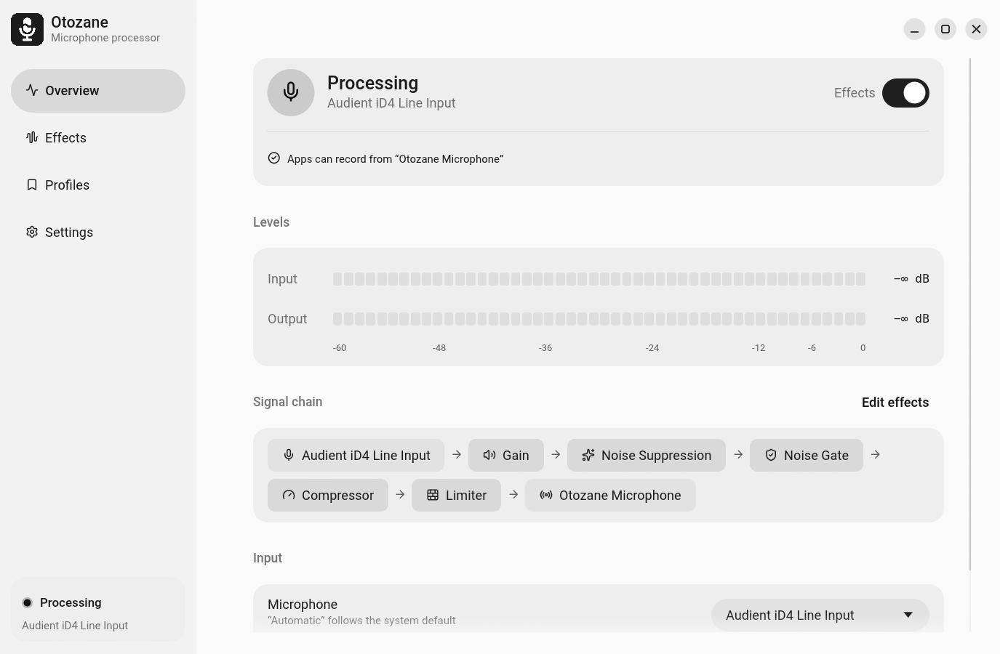
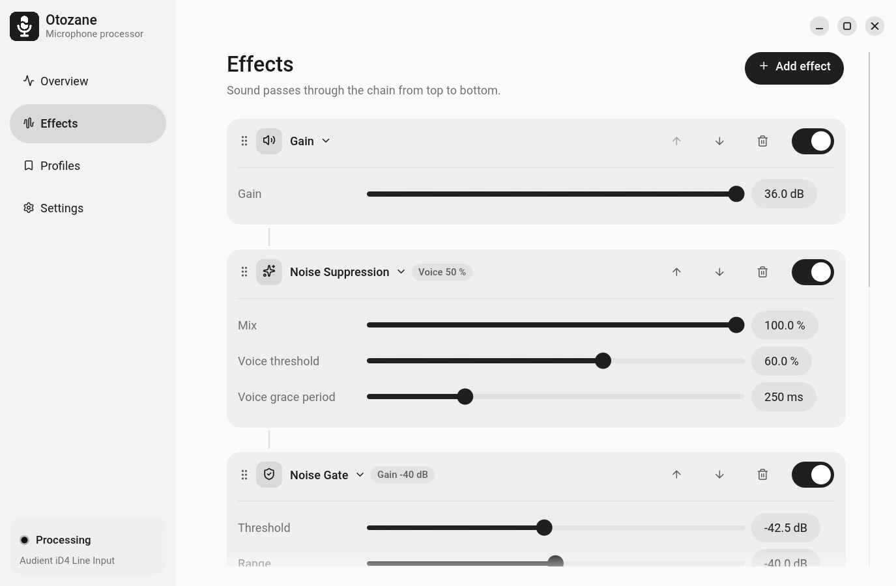
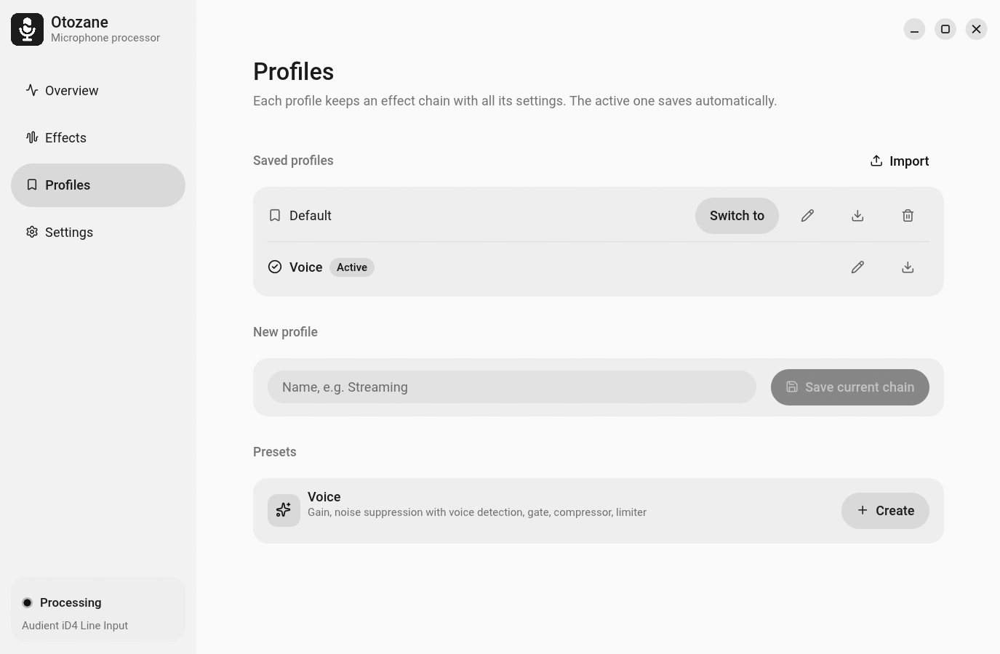
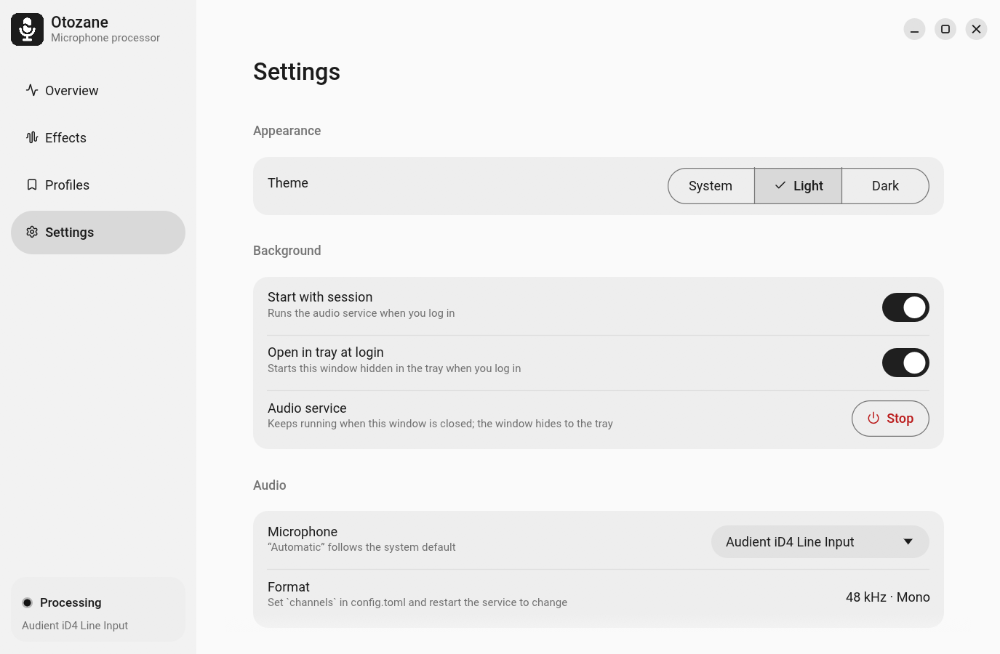

<p align="center">
  
</p>

<h1 align="center">Otozane</h1>

<p align="center">
  <b>Real-time microphone processor for Linux and macOS.</b><br>
  Captures a microphone through PipeWire or Core Audio, runs it through an effect chain<br>
  and publishes the result as a virtual input device.
</p>

<p align="center">
  <a href="https://github.com/binido/Otozane/releases/latest"></a>
  <a href="https://github.com/binido/Otozane/actions/workflows/release.yml"></a>
  
  
  
  <a href="LICENSE"></a>
</p>

<p align="center">
  <a href="#features">Features</a> ·
  <a href="#interface">Interface</a> ·
  <a href="#install">Install</a> ·
  <a href="#build-from-source">Build from source</a> ·
  <a href="#configuration">Configuration</a> ·
  <a href="#documentation">Documentation</a>
</p>

<p align="center">
  <picture>
    <source media="(prefers-color-scheme: dark)" srcset="docs/screenshots/overview-dark.png">
    
  </picture>
</p>

## Overview

```
Physical microphone → effect chain → Otozane Microphone → applications
```

Otozane creates a virtual input device named **Otozane Microphone**. Discord,
OBS, browsers and any other application that records from PipeWire can select it
as a regular microphone. On macOS the processed audio goes to
[BlackHole 2ch](https://existential.audio/blackhole/), and applications select
**BlackHole 2ch** instead, see [macOS](#macos).

Scope:

- Processes microphone input only.
- Does not modify system output, audio of other applications, or default devices.
- Audio runs in a background service (`otozaned`). The desktop app (`otozane`)
  is optional and only controls the service.

## Features

| Area | Details |
|---|---|
| Virtual device | `Otozane Microphone` is owned by the service and removed when the service stops. |
| Input | Microphone selection. **Automatic** follows the system default microphone. A device that is unplugged and plugged back in is picked up again. |
| Built-in effects | RNNoise noise suppression with optional voice-activity gate, Hush noise and background-speaker suppression, gain, noise gate, five-band parametric EQ, compressor, lookahead limiter. |
| Effect chain | Reorderable. Parameters apply live. Bypass is click-free and a bypassed effect uses no CPU. |
| Modes | **On**, **No effects** (microphone passes through unchanged), **Muted** (capture stops, `Otozane Microphone` outputs silence, almost no CPU). Muted is not remembered: the service always starts unmuted. |
| Listen to myself | **Overview → Input** plays the processed microphone, as apps hear it, to the system default output. Appears in the system mixer as `Otozane Monitor` for volume control. Not remembered: the service always starts with it off. Use headphones, speakers feed back into the microphone. |
| Voice preset | Gain, RNNoise with voice detection, gate, compressor, limiter. Default for new setups; **Profiles → Presets** creates it as a new profile. |
| Profiles | Create, rename, delete, switch, export to and import from `.toml`. The active profile is saved automatically. |
| VST3 plugins | Linux builds, for example `lsp-plugins-vst3`. Plugin browser with search, parameters, state stored in profiles. |
| Desktop app | egui. Light, dark and system themes, level meters, diagnostics. |
| Tray | StatusNotifierItem. Shows the service state, switches the mode, shows or hides the window, quits the app. Requires a tray host such as Waybar, KDE or Noctalia. |

Limitations:

- VST3 plugins are scanned in separate processes but run inside the service.
  A plugin that crashes during processing stops the service.
- Not implemented: JSFX, CLAP, plugin editor windows. See [PLAN.md](PLAN.md).

## Interface

<table>
  <tr>
    <td width="33%" valign="top">
      <picture>
        <source media="(prefers-color-scheme: dark)" srcset="docs/screenshots/effects-dark.png">
        
      </picture>
      <h4>Effects</h4>
      The chain is processed top to bottom. Each effect can be reordered, removed or bypassed.
    </td>
    <td width="33%" valign="top">
      <picture>
        <source media="(prefers-color-scheme: dark)" srcset="docs/screenshots/profiles-dark.png">
        
      </picture>
      <h4>Profiles</h4>
      Saved chains, import and export to <code>.toml</code>, built-in presets.
    </td>
    <td width="33%" valign="top">
      <picture>
        <source media="(prefers-color-scheme: dark)" srcset="docs/screenshots/settings-dark.png">
        
      </picture>
      <h4>Settings</h4>
      Theme, autostart of the service and the tray app, microphone, audio format.
    </td>
  </tr>
</table>

## Install

The installer selects a package from the latest
[release](https://github.com/binido/Otozane/releases/latest). Supported
architectures: x86_64, aarch64.

```sh
curl -fsSL https://raw.githubusercontent.com/binido/Otozane/main/scripts/install.sh | bash
```

| Distribution | Installed package |
|---|---|
| Arch, CachyOS, Manjaro, EndeavourOS | `otozane-bin`, built with `makepkg` from the release `PKGBUILD` |
| Debian 12+, Ubuntu 24.04+, Mint, Pop!_OS | `.deb` via `apt` |
| Fedora, openSUSE | `.rpm` via `dnf` or `zypper` |
| Other | Release tarball into `~/.local` |

Runtime requirements: PipeWire 0.3.49+, glibc 2.36+. RNNoise is built into the
release binaries; the Hush runtime and model ship in `/usr/lib/otozane/hush/`
(inside `Otozane.app` on macOS).

After installation, select **Otozane Microphone** as the input device in the
application you record with.

<details>
<summary>Manual installation from the release page</summary>

Arch family:

```sh
mkdir otozane-bin && cd otozane-bin
curl -fsSLO https://github.com/binido/Otozane/releases/latest/download/PKGBUILD
makepkg -si
```

Debian, Ubuntu:

```sh
sudo apt install ./otozane_<version>-1_amd64.deb
```

Fedora:

```sh
sudo dnf install ./otozane-<version>-1.x86_64.rpm
```

Any distribution, from the unpacked tarball:

```sh
./install.sh                # into ~/.local; use --prefix DIR for another location
./install.sh --uninstall
```

</details>

### macOS

macOS 26 or later, Apple Silicon.

1. Install BlackHole 2ch, the virtual device that applications record from:

   ```sh
   brew install blackhole-2ch
   ```

2. Download `otozane-v<version>-macos-arm64.dmg` from the
   [release page](https://github.com/binido/Otozane/releases/latest) and drag
   **Otozane** into **Applications**.
3. The app is not notarized. On first launch, right-click it in Finder and
   choose **Open**, or allow it in **System Settings → Privacy & Security**.
4. Allow microphone access when macOS asks.
5. Select **BlackHole 2ch** as the input device in the application you record with.

Differences from Linux:

- The output is BlackHole 2ch, not a device owned by Otozane. Everything any
  application plays into BlackHole is mixed with the processed microphone, so
  route other audio (for example Audio Hijack or a Multi-Output Device) elsewhere.
- **Automatic** skips virtual devices, including BlackHole, even when one is the
  system default input.
- Devices running at other rates (Bluetooth headsets at 16 kHz, outputs at
  44.1 kHz) are resampled to and from 48 kHz.
- **Settings → Start with session** installs a launchd agent,
  `~/Library/LaunchAgents/io.github.binido.otozane.plist`, pointing at the
  service inside `Otozane.app`. After moving the app, turn the option off and on again.
- The window uses the system frame. A microphone icon in the menu bar shows the
  service state, switches **On / No effects / Muted**, shows the window and quits.
  Closing the window only hides it, the menu bar icon or the Dock icon brings it back.
- Not available: VST3 plugins.

### Start with the session

Both options are off by default.

- **Settings → Start with session** writes `~/.config/systemd/user/otozane.service`
  pointing at the `otozaned` binary next to the app, and enables it. After moving
  the binaries, turn the option off and on again.
- **Settings → Open in tray at login** writes `~/.config/autostart/otozane.desktop`,
  which starts the app with `--hidden` (tray only, no window). Available only
  while a tray host is running.

<details>
<summary>Enable the service manually</summary>

```sh
install -Dm755 target/release/otozaned ~/.local/bin/otozaned
install -Dm644 packaging/otozane.service ~/.config/systemd/user/otozane.service
systemctl --user daemon-reload
systemctl --user enable --now otozane
```

</details>

With a tray host, closing the window hides it. The service keeps running in both
cases.

## Build from source

Requirements:

- Linux with PipeWire and WirePlumber (developed on CachyOS, PipeWire 1.6).
- Rust stable 1.85+, `clang` (for PipeWire bindings), `pkgconf`.
- System libraries `pipewire` and `rnnoise`. On Arch: `pacman -S pipewire rnnoise clang`.
- For Hush Noise Suppression: `git` and `scripts/build-hush.sh` (Linux and macOS), which builds
  the Hush runtime from source into `third_party/hush` (about 2 minutes). Without
  it Otozane works, and a Hush effect shows "Hush is not installed".

```sh
cargo build --release
./target/release/otozaned &      # audio service
./target/release/otozane          # desktop app; can start the service itself
```

Add the app to the application menu:

```sh
install -Dm644 packaging/otozane.svg ~/.local/share/icons/hicolor/scalable/apps/otozane.svg
install -Dm644 packaging/otozane.desktop ~/.local/share/applications/otozane.desktop
```

The desktop entry runs `otozane` from `PATH`.

On macOS (Rust and Xcode command line tools, BlackHole 2ch installed):

```sh
scripts/build-rnnoise.sh          # once: static RNNoise into third_party/rnnoise
cargo build --release
scripts/package-macos.sh 0.3.0 dist   # optional: Otozane.app in a .dmg
```

Releases are built by [`.github/workflows/release.yml`](.github/workflows/release.yml)
when a `vX.Y.Z` tag matching the version in `Cargo.toml` is pushed.

## Configuration

Location: `$XDG_CONFIG_HOME/otozane/` (usually `~/.config/otozane/`).
On macOS: `~/Library/Application Support/Otozane/`, or `$XDG_CONFIG_HOME/otozane/` when it is set.

| File | Contents |
|---|---|
| `config.toml` | Selected microphone, processing on/off, active profile, channel count |
| `profiles/<name>.toml` | Effect chains |
| `ui.toml` | UI theme |

Example profile:

```toml
[[chain]]
id = 1
kind = "rnnoise"
enabled = true
params = { mix = 100.0, vad_threshold = 0.0, vad_grace = 200.0 }

[[chain]]
id = 2
kind = "compressor"
params = { threshold = -18.0, ratio = 3.0 }
```

## Coexistence with EasyEffects

Otozane runs alongside EasyEffects and does not change its configuration.

With **Process all inputs** enabled, EasyEffects may move recording applications
onto its own source. Otozane's internal streams are excluded from this.
Applications that record from Otozane Microphone can still be moved; exclude them
in EasyEffects if needed.

## Documentation

| Document | Contents |
|---|---|
| [ARCHITECTURE.md](ARCHITECTURE.md) | Design and real-time model |
| [DEVELOPMENT.md](DEVELOPMENT.md) | Building, testing, verification scripts |
| [PLAN.md](PLAN.md) | Roadmap and status |
| [THIRD_PARTY.md](THIRD_PARTY.md) | Bundled assets and dependency licenses |

## License

MIT, see [LICENSE](LICENSE). Bundled fonts and icons keep their own licenses,
listed in [THIRD_PARTY.md](THIRD_PARTY.md).
